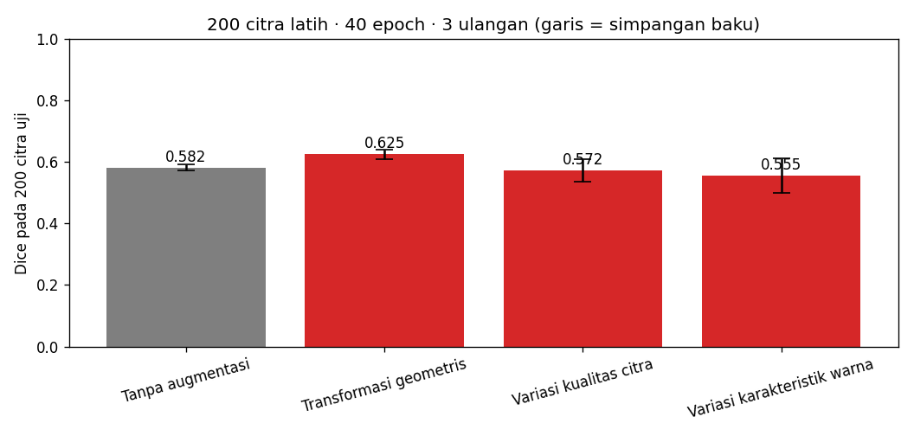
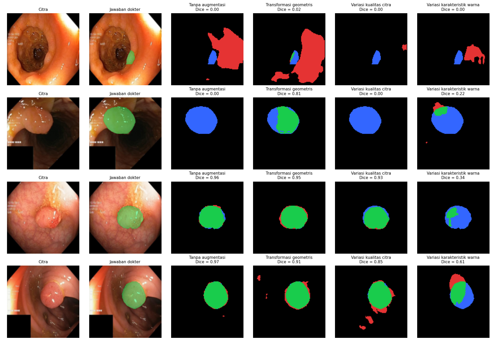

# Segmentasi Polip pada Citra Kolonoskopi dengan U-Net

**Tugas P10 Kecerdasan Buatan (BM25-41204)**  
Program Studi Teknik Biomedis, Institut Teknologi Sumatera

## Anggota Kelompok

1. Bintang Putra Gunawan
2. Aisyah Ratu Pratiwi
3. Gusti Ayu Tegar Ikhtiari Emily

## 1. Pertanyaan

Augmentasi apa yang dapat meningkatkan kemampuan model U-Net dalam melakukan segmentasi polip pada citra kolonoskopi, dan augmentasi apa yang justru memberikan hasil kurang baik?

## 2. Data dan Pengaturan Eksperimen

Dataset yang digunakan adalah Kvasir-SEG, yaitu dataset citra kolonoskopi yang dilengkapi dengan mask sebagai penanda area polip. Pada eksperimen ini, citra diolah dengan ukuran 128 × 128 piksel.

Model yang digunakan adalah U-Net Mini dengan pengaturan sebagai berikut:

- Data latih: 200 citra.
- Data uji: 200 citra.
- Ukuran citra: 128 × 128 piksel.
- Optimizer: Adam.
- Learning rate: 0,001.
- Jumlah epoch: 40.
- Pengulangan eksperimen: 3 kali untuk setiap skenario.
- Perangkat komputasi: GPU CUDA.

## 3. Skenario Augmentasi dan Hipotesis

Terdapat empat skenario yang diuji, yaitu satu skenario tanpa augmentasi dan tiga skenario dengan jenis augmentasi yang berbeda.

| Skenario | Teknik yang Digunakan | Hipotesis |
|---|---|---|
| Tanpa augmentasi | Citra digunakan tanpa perubahan | Digunakan sebagai pembanding terhadap skenario lainnya |
| Transformasi geometris | Horizontal flip, vertical flip, dan rotasi hingga 180° | Model diharapkan dapat mengenali polip meskipun posisi dan orientasinya berubah |
| Variasi kualitas citra | Perubahan brightness, contrast, dan Gaussian blur | Model diharapkan lebih mampu mengenali polip pada kondisi pencahayaan dan ketajaman yang berbeda |
| Variasi karakteristik warna | Perubahan saturation dan hue | Model diharapkan dapat mengenali polip meskipun terdapat perubahan warna pada citra |

## 4. Hasil Eksperimen

Hasil setiap skenario dibandingkan menggunakan Dice Score dan Intersection over Union (IoU). Pengujian dilakukan sebanyak tiga kali untuk setiap skenario, kemudian dihitung nilai rata-rata dan simpangan bakunya.

| Skenario | Dice (Rata-rata ± SB) | IoU (Rata-rata ± SB) |
|---|---:|---:|
| Tanpa augmentasi | 0,582 ± 0,010 | 0,465 ± 0,009 |
| Transformasi geometris | 0,625 ± 0,016 | 0,505 ± 0,014 |
| Variasi kualitas citra | 0,572 ± 0,036 | 0,450 ± 0,027 |
| Variasi karakteristik warna | 0,555 ± 0,055 | 0,435 ± 0,047 |

**Grafik Perbandingan Hasil**

Hasil lengkap setiap pengulangan dapat dilihat pada file [ringkasan.md](ringkasan.md).

## 5. Analisis Peta Kesalahan

Peta kesalahan digunakan untuk melihat bagian hasil segmentasi yang berbeda dari mask sebenarnya. Dari visualisasi ini, dapat diamati bagian polip yang berhasil terdeteksi serta bagian yang masih mengalami kesalahan, seperti area polip yang tidak terdeteksi atau area di luar polip yang ikut tersegmentasi.

## 6. Pembahasan dan Kesimpulan

Berdasarkan hasil pengujian, transformasi geometris memberikan hasil terbaik dengan rata-rata Dice sebesar 0,625 dan IoU sebesar 0,505. Nilai tersebut lebih tinggi dibandingkan skenario tanpa augmentasi yang memperoleh Dice sebesar 0,582 dan IoU sebesar 0,465.

Pada skenario variasi kualitas citra, nilai Dice yang diperoleh adalah 0,572. Hasil ini sedikit lebih rendah dibandingkan skenario tanpa augmentasi. Hal serupa juga terlihat pada variasi karakteristik warna yang memperoleh nilai Dice sebesar 0,555.

Dari hasil tersebut, dapat dilihat bahwa penggunaan augmentasi tidak selalu meningkatkan hasil segmentasi. Dalam eksperimen ini, transformasi geometris memberikan hasil yang lebih baik, sedangkan variasi kualitas citra dan warna belum memberikan peningkatan dibandingkan kondisi tanpa augmentasi.

## 7. Pembagian Kerja

Pengerjaan tugas dibagi berdasarkan beberapa bagian utama, yaitu:

1. **Bintang Putra Gunawan:** Mempelajari materi terkait segmentasi citra dan konsep dasar U-Net.
2. **Aisyah Ratu Pratiwi:** Mempelajari jenis augmentasi citra serta membantu pembahasan hasil eksperimen.
3. **Gusti Ayu Tegar Ikhtiari Emily:** Menyiapkan dan menjalankan notebook, melakukan pengujian setiap skenario, mengolah hasil, serta menyusun dokumentasi proyek.

## 8. Penggunaan AI

AI digunakan sebagai alat bantu untuk memahami materi U-Net dan augmentasi citra, membantu pemeriksaan kode, serta mendiskusikan hasil eksperimen dan penyusunan dokumentasi. Hasil pengujian yang dicantumkan tetap mengacu pada proses eksperimen yang dilakukan dalam notebook.

## Cara Menjalankan Notebook

1. Buka file `segmentasi_polip.ipynb`.
2. Jalankan notebook menggunakan Google Colab atau Jupyter Notebook.
3. Siapkan dataset Kvasir-SEG sesuai lokasi yang digunakan dalam notebook.
4. Jalankan setiap sel secara berurutan untuk melihat proses pelatihan dan hasil evaluasi model.

## Referensi

1. Jha, D., et al. (2020). *Kvasir-SEG: A Segmented Polyp Dataset*.
2. Ronneberger, O., Fischer, P., & Brox, T. (2015). *U-Net: Convolutional Networks for Biomedical Image Segmentation*.
